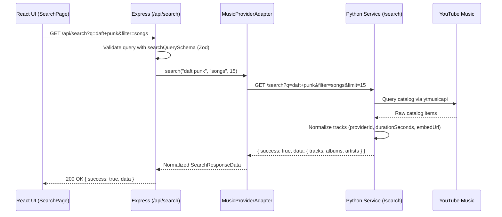

# System Design — VibeFlow

## 1. Component Topology

```mermaid
flowchart LR
    Browser["React SPA (src/)"] -->|HTTPS + HttpOnly Cookie| Express["Express API (backend/src/)"]
    Express -->|Mongoose ODM| MongoDB[("MongoDB")]
    Express -->|Internal HTTP (8.5s Timeout)| PythonSvc["Python Music Service (music-service/)"]
    PythonSvc -->|ytmusicapi| YTMusic["YouTube Music Catalog"]
    Browser -->|Authorized Embed| YTPlayer["YouTube IFrame Player API"]
```

## 2. Core Request Sequences

### Search & Discovery Sequence



## 3. Failure Handling & Timeouts

- **Python Provider Timeouts**: `musicProviderAdapter.ts` enforces an 8.5-second timeout and maps `ECONNABORTED` or upstream `504` to `504 MUSIC_PROVIDER_TIMEOUT`.
- **Service Unreachable**: If `music-service` is offline, Express returns `503 MUSIC_SERVICE_UNREACHABLE`, and the React UI displays an error banner with a **Retry** button—never fake results.
